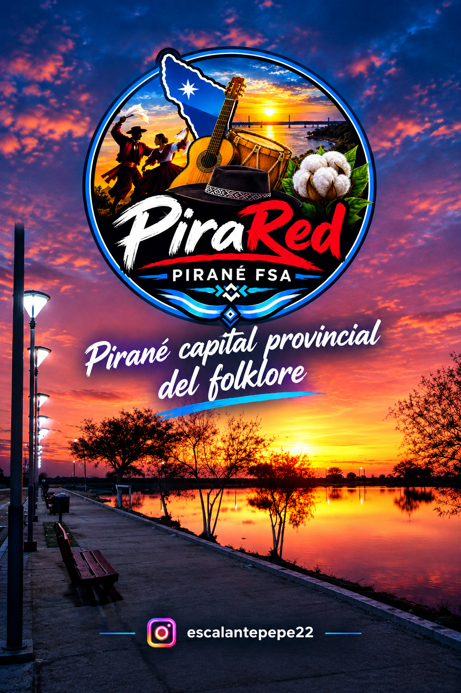
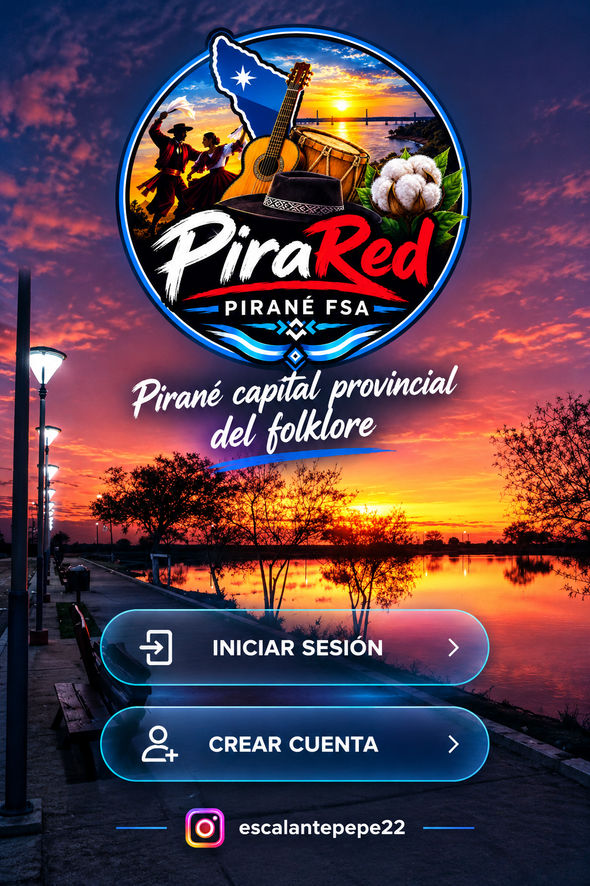
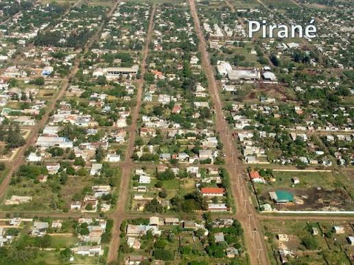
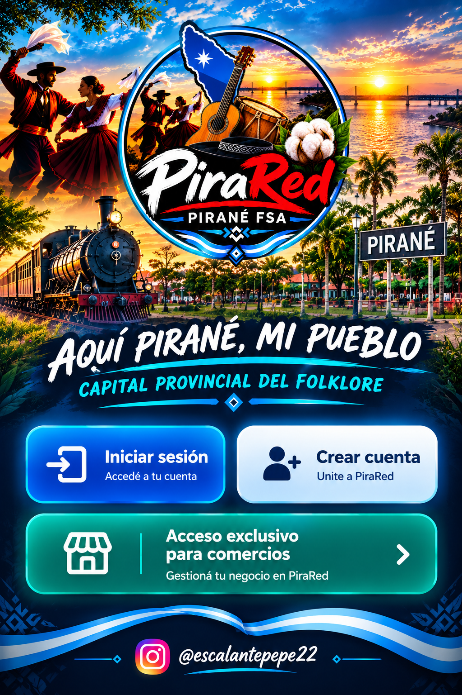

# PiraRed — documentación general del proyecto

PiraRed es una aplicación Android orientada a la comunidad de Pirané y alrededores, Formosa, Argentina. Este documento reúne el propósito, la estructura del proyecto, los recursos visuales, la compilación, las pautas de seguridad y el estado de verificación. El registro complementario de cambios está en [Léeme Pepe](LEEME_PEPE.md). La presencia de código o archivos en el repositorio no garantiza por sí sola que una función esté probada en el teléfono.

## Estado actual — portadas nuevas incorporadas al código

Se agregaron al repositorio dos imágenes nuevas que el usuario subió y se actualizó `index.html` para usarlas por separado:

- **Bienvenida, sin botones:** `app/Img/file_00000000bf30820ea0628bc7e7035328.png`
- **Acceso, con “INICIAR SESIÓN” y “CREAR CUENTA”:** `app/Img/file_000000005d30820e921dc8703d3997dc.png`

La pantalla de bienvenida usa la primera imagen; la portada principal usa la segunda. La proporción del contenedor se cambió a 2:3 y la imagen se ajusta con `object-fit: cover` para evitar el estiramiento. La portada de acceso mantiene las zonas táctiles y acciones definidas en el HTML; hay que comprobar en el dispositivo que coincidan con los botones impresos en la imagen.

**Commit de la actualización de portadas:** `501a22d3eac85c6873769ab73fd8d7279aea8e99`.

**Compilación automática:** [ver la ejecución de GitHub Actions](https://github.com/atake42je-gif/Pira-red/actions/runs/40207471776). Al redactar esta sección, la ejecución estaba en curso; no marcar la APK como lista hasta que GitHub Actions finalice con éxito y se confirme el artefacto descargable.

Las portadas anteriores `portada-pirared.png` y `01-inicio-pirared.png` se conservan como recursos del repositorio por ahora; no se borran automáticamente porque todavía pueden estar referenciadas en otras partes del proyecto. Cuando la APK nueva esté validada, se puede hacer una limpieza de archivos antiguos revisando primero todas sus referencias.

## Propósito y alcance

PiraRed busca reunir información y servicios útiles para la comunidad local en una aplicación accesible desde Android. La dirección del producto incluye exploración, cuentas de usuarios, publicaciones comunitarias, comercios, servicios y contacto privado. Cada módulo debe considerarse **pendiente de validación funcional** hasta probarse con el backend y en el teléfono.

## Estructura principal del repositorio

- `app/src/main/assets/www/index.html`: interfaz web que se muestra dentro del WebView Android.
- `app/src/main/assets/www/app/Img/`: imágenes y recursos visuales de la aplicación.
- `app/src/main/java/ar/pirared/app/`: código Android que abre la interfaz local en un WebView.
- `.github/workflows/build APK.yml`: flujo de GitHub Actions para compilar la APK.
- `README.md`: esta documentación general.
- `LEEME_PEPE.md`: registro complementario de cambios y notas del proyecto.

## Compilar e instalar la APK

1. Abrir la pestaña **Actions** del repositorio.
2. Elegir el flujo **Generar APK de PiraRed** (archivo `.github/workflows/build APK.yml`).
3. Esperar a que la ejecución termine. Si falla, revisar los logs del paso rojo antes de intentar instalar.
4. Abrir la ejecución exitosa y descargar el artefacto APK publicado por el flujo.
5. Instalarlo en el teléfono y comprobar que la versión y las imágenes sean las esperadas.

No se debe afirmar que existe una APK nueva descargable hasta que el flujo finalice correctamente y el artefacto esté publicado. Para futuras actualizaciones de la misma instalación se debe mantener una firma de lanzamiento estable. No guardar keystores, contraseñas ni claves administrativas en el repositorio.

## Seguridad y privacidad — principios de implementación

- Mantener privados los datos personales y no mostrar números de teléfono en la mensajería interna.
- No guardar claves administrativas ni claves `service_role` de Supabase en el código de cliente.
- Usar políticas de seguridad de filas (RLS) en todas las tablas que contengan datos de usuarios, publicaciones, comercios o mensajes.
- Verificar autorización en el backend; ocultar un botón en la interfaz no es una medida de seguridad suficiente.
- Probar invitado, usuario común, comercio pendiente, comercio aprobado y administrador con permisos separados.
- Tratar los enlaces, archivos y publicaciones de usuarios como contenido no confiable; contemplar denuncias, bloqueo, moderación y protección contra spam.
- Publicar política de privacidad y términos claros antes del lanzamiento público.
- La verificación de identidad avanzada queda fuera del alcance confirmado actual; se prioriza un método gratuito, seguro y que minimice la recolección de datos.

## Portadas nuevas — imágenes originales

Estas son las dos imágenes nuevas que el usuario subió al repositorio y que se conectaron al código de la app. Se muestran aquí en el mismo orden de uso:

### 1. Bienvenida — sin botones

Archivo: [`file_00000000bf30820ea0628bc7e7035328.png`](app/src/main/assets/www/app/Img/file_00000000bf30820ea0628bc7e7035328.png)

### 2. Acceso — con botones

Archivo: [`file_000000005d30820e921dc8703d3997dc.png`](app/src/main/assets/www/app/Img/file_000000005d30820e921dc8703d3997dc.png)

> Las imágenes se enlazan directamente a los archivos PNG originales del repositorio. La vista del README documenta las imágenes guardadas en GitHub; la visualización final y las zonas táctiles deben comprobarse en la APK instalada.

## Estado visual comprobado en el código

Los cambios de interfaz y la galería que ya se incorporaron no se repiten como tareas pendientes. Quedan abajo únicamente las comprobaciones que todavía requieren validación o trabajo nuevo.

## Estilo visual acordado (mantener en todas las pantallas)

- Identidad moderna, simple, distintiva y claramente de Pirané; las fotos originales del pueblo son protagonistas.
- Fondo con fotografía original de Pirané, algo más claro que la versión oscura anterior, con contornos/detalles sutiles; evitar que la app quede negra.
- Mantener el fondo y las fotos visibles (la preferencia expresada fue alrededor del 90% de visibilidad), con buena calidad y sin deformarlas.
- La portada de tren aprobada es una imagen terminada: se muestra grande y a pantalla completa, sin ningún texto, logo, botón visible, filtro ni capa superpuesta. No recrearla con HTML ni reemplazarla por otra foto.
- Separar completamente la portada de la pantalla de inicio de sesión/registro. Las zonas táctiles pueden ser transparentes, pero no deben cambiar visualmente la imagen.
- En pantallas internas usar una interfaz limpia, fácil de navegar, con tonos celestes/azules claros, paneles sutiles y contraste legible, conservando la identidad local.
- Usar exclusivamente las imágenes originales que envió el usuario; no sustituirlas por imágenes generadas ni fotos parecidas.
- Referencia anterior de la imagen de portada/logo: imagen grande, centrada, proporcional y sin deformación. La portada actual elegida por el usuario prevalece sobre cualquier diseño anterior.

- La portada de Inicio usa actualmente la nueva imagen de acceso `app/Img/file_000000005d30820ea0628bc7e7035328.png`; la bienvenida usa `app/Img/file_00000000bf30820ea0628bc7e7035328.png`. La imagen de tren `01-inicio-pirared.png` se conserva como recurso anterior.
- La pantalla Información usa `app/Img/04-informacion-pirared.jpg`.
- La portada se ajustó a pantalla completa y se quitaron los textos/capas duplicados sobre la imagen. Se conservaron zonas táctiles para los accesos; su alineación con los botones dibujados en la foto debe probarse en un teléfono.
- La imagen original se muestra sin filtro ni capa oscura añadida; el recorte final depende de la proporción de cada dispositivo. Hay que comprobar la APK instalada porque el código del repositorio no demuestra qué versión está en el teléfono.
- Se agregó a `index.html` una pantalla **Fotos** con las 14 imágenes del directorio canónico. La galería se ordenó para respetar primero la secuencia principal solicitada (portada, imagen pendiente de confirmar como estatua, placita, monumento de los 50 años, cartel YO ❤️ PIRANÉ e información); después aparecen los recursos complementarios. Las fotos genéricas siguen identificadas como pendientes. La galería aún requiere prueba visual en la APK instalada.
- Se limpiaron copias idénticas de imágenes. Se conservaron archivos visualmente distintos aunque todavía falte clasificarlos.

## Pendientes reales de desarrollo y verificación

### 1. APK y teléfono
- [ ] Confirmar que la compilación iniciada por el commit de las portadas finalice correctamente y publique el artefacto APK.
- [ ] Descargar e instalar la APK nueva en el teléfono.
- [ ] Probar todas las pantallas, botones, navegación atrás, orientación y distintos tamaños de pantalla.
- [ ] Confirmar que la portada original no tenga elementos visuales superpuestos y que las zonas táctiles invisibles coincidan con los botones dibujados.
- [ ] Confirmar que la APK instalada contiene la última interfaz y las dos portadas nuevas.
- [ ] Configurar y probar una firma estable de lanzamiento para futuras actualizaciones; no guardar keystore ni contraseñas en GitHub.

### 2. Supabase y seguridad
- [ ] Confirmar que la URL y la clave pública configuradas en la app correspondan al proyecto Supabase correcto.
- [ ] Confirmar que las migraciones SQL estén aplicadas en ese proyecto y que tablas y columnas coincidan con las consultas de la interfaz.
- [ ] Verificar RLS y permisos de perfiles, comercios y promociones, incluyendo intentos de acceso no autorizado.
- [ ] Probar registro, inicio/cierre de sesión, sesión persistente y recuperación de contraseña.
- [ ] Probar errores de red, falta de conexión y respuestas inválidas sin exponer tokens ni datos privados.
- [ ] No incluir claves service-role, credenciales administrativas ni contraseñas en el cliente o en GitHub.

### 3. Diseño e imágenes — comprobaciones pendientes
- [ ] Confirmar en el teléfono que las 14 imágenes de la galería carguen correctamente en la APK.
- [ ] Identificar cuál de las imágenes originales corresponde a la estatua; no asignar una foto por suposición.
- [ ] Comprobar que no aparezca un fondo negro involuntario.
- [ ] Probar cada botón, enlace y regreso a Inicio; corregir los que no tengan una acción funcional.
- [ ] Mantener separada la portada de Inicio del formulario de acceso: Iniciar sesión y Crear cuenta deben abrir la pantalla de cuenta; Acceso para comercios debe abrir su sección independiente.
- [ ] Tomar capturas reales de Inicio, Explorar, Publicar, Comercios, Perfil e Información para documentar el aspecto real de la APK.
- [ ] Confirmar la ubicación exacta de la foto del paseo al atardecer y la del Camping La Esperanza.
- [ ] Verificar que la foto nocturna del cartel de ingreso esté guardada en versión limpia y de alta calidad.
- [ ] Confirmar que cada archivo de la galería exista en la ruta indicada y se vea correctamente en el teléfono.

### 4. Funciones comunitarias
- [ ] Implementar exploración como invitado con permisos limitados.
- [ ] Definir las acciones que requieren cuenta completa y un método de verificación gratuito y seguro.
- [ ] Implementar publicaciones comunitarias de productos, changas y servicios, con validación y moderación.
- [ ] Implementar edición y eliminación autorizada de publicaciones propias.
- [ ] Implementar mensajería privada entre vecinos sin mostrar números de teléfono.
- [ ] Añadir bloqueo, denuncias y medidas contra spam y abuso.
- [ ] Crear un panel administrativo seguro para revisar cuentas, comercios, promociones y denuncias.

### 5. Privacidad y lanzamiento
- [ ] Publicar una política de privacidad y términos de uso acordes a las funciones reales.
- [ ] Explicar qué datos se recopilan, por qué, cuánto tiempo se conservan y cómo solicitar su eliminación.
- [ ] Probar con cuentas de invitado, usuario común, comercio pendiente, comercio aprobado y administrador.
- [ ] Revisar mensajes y registros para evitar exponer tokens, claves o datos personales.
- [ ] Documentar instalación, actualización y recuperación segura de la firma.

## Galería de imágenes — archivos actuales del repositorio

**Las imágenes se enlazan desde la carpeta real** `app/src/main/assets/www/app/Img/`. Esta lista refleja los 14 archivos que están actualmente en esa carpeta de `main`. GitHub puede mostrar las vistas previas al abrir el README.

### Secuencia principal obligatoria

**1. Recurso anterior de Inicio — tren con PiraRed.** Se conserva como imagen histórica; las pantallas actuales se conectaron a las dos portadas nuevas listadas arriba.

**2. Estatua / monumento de plaza.** El archivo está presente, pero hay que confirmar que sea exactamente la estatua pedida antes de etiquetarlo definitivamente.

**3. Placita / parque con juegos.**

**4. Monumento de los 50 años.**

**5. Cartel nocturno “YO ❤️ PIRANÉ”.**

**6. Información de la app.** Cierra la secuencia principal.

### Imágenes complementarias y archivos conservados

**7. Vista aérea de Pirané.**

**8. Logo de PiraRed.** Recurso del logo; no reemplaza la portada del tren.

**9. Detalles de la app — imagen del tren.**

**10. Foto original pendiente de identificar — `images (3).jpeg`.**
.jpeg)

**11. Foto original pendiente de identificar — `images (4).jpeg`.**
.jpeg)

**12. Foto original pendiente de identificar — `images (9).jpeg`.**
.jpeg)

**13. Logo original conservado.**

**14. Portada anterior conservada.** La portada aprobada actualmente para bienvenida y acceso son los dos PNG nuevos descritos en la sección de estado actual.

### Fotos reales solicitadas que todavía deben cotejarse

Las siguientes fotos/temas se mencionaron en la conversación, pero no se les asigna un nombre de archivo sin comprobar que la foto correcta esté entre los archivos anteriores: torre azul de la plaza, plaza con mástil y banderas, paseo junto al agua al atardecer, cartel de ingreso a Pirané de noche, Camping La Esperanza, pareja bailando folclore y capullo de algodón. No sustituirlas por imágenes inventadas o paisajes parecidos.

### Comprobaciones pendientes

- Confirmar si `02-monumento-plaza.jpg` es la estatua exacta solicitada.
- Identificar las tres fotos con nombres genéricos antes de atribuirles un lugar.
- Comparar las imágenes complementarias solicitadas con los archivos originales enviados y agregar las que falten usando sus fotos auténticas.
- Abrir la APK en el teléfono y comprobar que las imágenes se carguen y se vean completas. Que aparezcan en este README solo documenta los archivos del repositorio; no prueba por sí solo su presentación en la app.

## Referencia visual acordada: vidrio claro (glassmorphism)

La imagen de pantallas compartida por el usuario es **una referencia de diseño**, no una captura de la app actual ni una orden de copiar cada pantalla literalmente. La app debe conservar las funciones y las fotos reales de Pirané que el usuario adjunta y tiene en el repositorio.

- Usar paneles tipo vidrio translúcido (glassmorphism): superficies celestes/blancas semitransparentes, bordes suaves, esquinas redondeadas y sombras discretas.
- Aclarar la interfaz respecto de la versión oscura: el fondo fotográfico real debe seguir viéndose claramente a través de los paneles; evitar una capa negra dominante.
- Mantener contraste suficiente para leer textos y distinguir botones; el efecto vidrio nunca debe perjudicar accesibilidad ni legibilidad.
- Usar azul/celeste PiraRed para acciones principales, iconos y estados seleccionados; verde solo como acento de estado cuando corresponda.
- Las fotografías reales de Pirané son el fondo y contenido visual principal. No reemplazarlas por las fotos de muestra de la maqueta ni por imágenes generadas. Mantener proporciones, calidad y recortes cuidadosos.
- Mantener consistencia entre portada, Inicio, Compra/Venta, Trabajos y Changas, cajeros, publicaciones/reclamos, Policía, perfil y administración. La maqueta es orientativa: no afirmar que esas pantallas/funciones están implementadas hasta probarlas.
- Revisar en teléfono el equilibrio entre transparencia y lectura, especialmente con fondos claros y nocturnos.

### Fotografías reenviadas para cotejar

El usuario volvió a adjuntar las fotografías reales del pueblo, el logo y la imagen de información. Antes de agregarlas o reemplazar recursos, comparar cada archivo con los recursos existentes en `app/src/main/assets/www/app/Img/`, identificar duplicados y conservar los originales distintos. No asignar una foto a la estatua ni a otro lugar por suposición. Registrar en este README cualquier recurso nuevo y su función solo después de verificarlo.

## Última compilación verificada — 25 de octubre de 2026

- La ejecución de GitHub Actions [40181089631](https://github.com/atake42je-gif/Pira-red/actions/runs/40181089631) compiló y verificó la APK correctamente para el commit `31907a51ad5c952e23edcda57cb6fed063e834ef`.
- Artefacto `PiraRed-APK`: [descargar desde los artefactos de Actions](https://github.com/atake42je-gif/Pira-red/actions/runs/40181089631).
- **Pendiente importante:** el éxito de compilación no demuestra que se instale sobre la versión ya instalada. El workflow genera una APK de prueba si no están configurados los secretos privados de firma (`ANDROID_KEYSTORE_BASE64`, `ANDROID_KEYSTORE_PASSWORD`, `ANDROID_KEY_ALIAS`, `ANDROID_KEY_PASSWORD`). Una APK firmada con otra clave no puede actualizar la instalación existente; no subir el keystore ni sus contraseñas al repositorio.

## Actualización visual — 25 de octubre de 2026

- Se ajustó la galería para preservar la fotografía completa y evitar recortes agresivos, manteniendo tarjetas claras, bordes suaves y fondo celeste translúcido.
- Se corrigió la cuadrícula de navegación inferior: ahora contempla las seis secciones visibles.
- Se mantuvo intacta la portada original elegida por el usuario; no se agregó un lema ni textos visuales nuevos sobre la imagen.
- Estos cambios ya están en `main`. La compilación automática y la prueba en el teléfono son pasos separados; no declarar terminada la app hasta revisar el resultado real.
