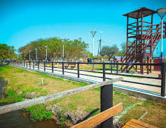
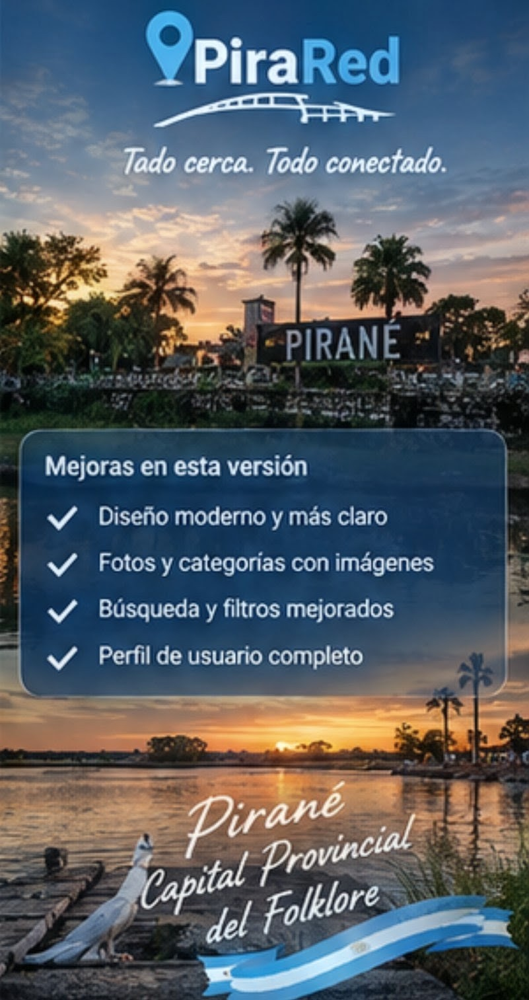

# PiraRed — pendientes y revisión visual

PiraRed es una app Android para la comunidad de Pirané. El registro de cambios realizados está en [Léeme Pepe](LEEME_PEPE.md). Este README se usa para seguir lo que falta y revisar los recursos visuales; no debe interpretarse como prueba de que una función ya funciona en el teléfono.

## Estado visual comprobado en el código

## Estilo visual acordado (mantener en todas las pantallas)

- Identidad moderna, simple, distintiva y claramente de Pirané; las fotos originales del pueblo son protagonistas.
- Fondo con fotografía original de Pirané, algo más claro que la versión oscura anterior, con contornos/detalles sutiles; evitar que la app quede negra.
- Mantener el fondo y las fotos visibles (la preferencia expresada fue alrededor del 90% de visibilidad), con buena calidad y sin deformarlas.
- La portada de tren aprobada es una imagen terminada: se muestra grande y a pantalla completa, sin ningún texto, logo, botón visible, filtro ni capa superpuesta. No recrearla con HTML ni reemplazarla por otra foto.
- Separar completamente la portada de la pantalla de inicio de sesión/registro. Las zonas táctiles pueden ser transparentes, pero no deben cambiar visualmente la imagen.
- En pantallas internas usar una interfaz limpia, fácil de navegar, con tonos celestes/azules claros, paneles sutiles y contraste legible, conservando la identidad local.
- Usar exclusivamente las imágenes originales que envió el usuario; no sustituirlas por imágenes generadas ni fotos parecidas.
- Referencia anterior de la imagen de portada/logo: imagen grande, centrada, proporcional y sin deformación. La portada actual elegida por el usuario prevalece sobre cualquier diseño anterior.

- La portada de Inicio usa `app/Img/01-inicio-pirared.png`, renombrada conservando exactamente el mismo archivo original del tren con PiraRed.
- La pantalla Información usa `app/Img/04-informacion-pirared.jpg`.
- La portada se ajustó a pantalla completa y se quitaron los textos/capas duplicados sobre la imagen. Se conservaron zonas táctiles para los accesos; su alineación con los botones dibujados en la foto debe probarse en un teléfono.
- La imagen original se muestra sin filtro ni capa oscura añadida; el recorte final depende de la proporción de cada dispositivo. Hay que comprobar la APK instalada porque el código del repositorio no demuestra qué versión está en el teléfono.
- Se agregó a `index.html` una pantalla **Fotos** con una galería que muestra los 14 archivos de imagen presentes en `app/Img/`, incluyendo las fotos locales, las portadas y los logos. Las tres imágenes con nombres genéricos se etiquetan como pendientes de identificación; no se les atribuye un lugar por suposición. Esto integra las imágenes en la interfaz, pero todavía debe comprobarse visualmente en la APK instalada.
- Se limpiaron copias idénticas de imágenes. Se conservaron archivos visualmente distintos aunque todavía falte clasificarlos.

## Pendientes de desarrollo y verificación

### 1. APK y teléfono
- [ ] Generar/descargar e instalar la APK más reciente en el teléfono.
- [ ] Probar todas las pantallas, botones, navegación atrás, orientación y distintos tamaños de pantalla.
- [ ] Confirmar que la portada original no tenga ningún elemento visual superpuesto; las zonas táctiles invisibles no deben dibujar botones ni textos.
- [ ] Confirmar que la APK instalada contiene la última interfaz y las imágenes correctas.
- [ ] Confirmar y probar una firma estable de lanzamiento antes de distribuir actualizaciones; no guardar keystore ni contraseñas en GitHub.

### 2. Supabase y seguridad
- [ ] Confirmar que la URL y la clave pública configuradas en la app correspondan al proyecto Supabase correcto.
- [ ] Confirmar que las migraciones SQL estén aplicadas en ese proyecto y que tablas y columnas coincidan con las consultas de la interfaz.
- [ ] Verificar RLS y permisos de perfiles, comercios y promociones, incluyendo intentos de acceso no autorizado.
- [ ] Probar registro, inicio/cierre de sesión, sesión persistente y recuperación de contraseña.
- [ ] Probar errores de red, falta de conexión y respuestas inválidas sin exponer tokens ni datos privados.
- [ ] No incluir claves service-role, credenciales administrativas ni contraseñas en el cliente o en GitHub.

### 3. Diseño, imágenes y navegación
- [ ] Confirmar visualmente que la portada de inicio sea la imagen original del tren con PiraRed, grande y legible.
- [ ] Identificar cuál de las imágenes originales sin nombre descriptivo corresponde a la estatua; no asignar una foto por suposición.
- [ ] Verificar el orden solicitado: **tren/inicio → estatua → placita/parque → monumento de los 50 años → cartel “YO ❤️ PIRANÉ” → información de la app**.
- [x] Agregar una pantalla Fotos con una galería que presenta todas las imágenes que actualmente existen en `app/Img/`.
- [ ] Confirmar en el teléfono que las 14 imágenes de la galería carguen correctamente en la APK.
- [ ] Revisar carga, calidad, recorte y legibilidad de cada imagen en el teléfono.
- [ ] Comprobar que no aparezca un fondo negro involuntario.
- [ ] Probar cada botón, enlace y regreso a Inicio; corregir los que no tengan una acción funcional.
- [ ] Mantener separada la portada de Inicio del formulario de acceso: Iniciar sesión y Crear cuenta deben abrir la pantalla de cuenta; Acceso para comercios debe abrir su sección independiente.
- [ ] Tomar capturas reales de Inicio, Explorar, Publicar, Comercios, Perfil e Información para documentar el aspecto real de la APK.

### 4. Funciones comunitarias
- [ ] Implementar exploración como invitado con permisos limitados.
- [ ] Definir las acciones que requieren cuenta completa y un método de verificación gratuito y seguro.
- [ ] Implementar publicaciones comunitarias de productos, changas y servicios, con validación y moderación.
- [ ] Implementar edición y eliminación autorizada de publicaciones propias.
- [ ] Implementar mensajería privada entre vecinos sin mostrar números de teléfono.
- [ ] Añadir bloqueo, denuncias y medidas contra spam y abuso.
- [ ] Crear un panel administrativo seguro para revisar cuentas, comercios, promociones y denuncias.

### 5. Privacidad y lanzamiento
- [ ] Publicar una política de privacidad y términos de uso acordes a las funciones reales.
- [ ] Explicar qué datos se recopilan, por qué, cuánto tiempo se conservan y cómo solicitar su eliminación.
- [ ] Probar con cuentas de invitado, usuario común, comercio pendiente, comercio aprobado y administrador.
- [ ] Revisar mensajes y registros para evitar exponer tokens, claves o datos personales.
- [ ] Documentar instalación, actualización y recuperación segura de la firma.

## Galería de imágenes — orden obligatorio para la app

**Respetar este orden al mostrar las imágenes.** La portada es una imagen completa y separada; las demás fotos deben aparecer en sus secciones correspondientes. No inventar fotos ni cambiar una por otra parecida.

1. **Inicio / bienvenida:** imagen original del tren con PiraRed. Debe ocupar la pantalla de inicio completa, sin lema, texto, botones visibles ni capas adicionales por encima de la imagen.
   

2. **Estatua:** usar únicamente la foto original de la estatua enviada por el usuario. Si no está identificada con certeza entre los archivos del repositorio, dejar pendiente y pedir confirmación; no asignar otra imagen por suposición.

3. **Placita / parque:** foto original de la placita con bancos y juegos.
   

4. **Monumento de los 50 años:** usar la foto original correspondiente a ese monumento.
   

5. **Cartel “YO ❤️ PIRANÉ”:** foto nocturna original del cartel de Pirané, sin la interfaz de TikTok/Instagram ni barras del teléfono. La versión limpia debe conservar la calidad de la foto y no alterar el cartel.
   

6. **Información de la app:** imagen original de información de PiraRed. Siempre va última en esta secuencia.
   

### Otras fotos reales de Pirané para secciones complementarias

Estas imágenes son recursos complementarios y **no cambian el orden obligatorio de las seis imágenes anteriores**:

- **Monumento/torre azul de la plaza:** foto real enviada por el usuario; usar en lugares destacados de Pirané.
- **Plaza con mástil y banderas:** foto real enviada por el usuario; usar como otra vista de la plaza.
- **Paseo junto al agua al atardecer:** foto real enviada por el usuario; asignar al lugar correcto solo cuando se confirme su ubicación.
- **Cartel de ingreso “PIRANÉ” de noche:** foto real enviada como captura de una publicación. Para integrarla, recortar la interfaz del teléfono y conservar solo la fotografía, sin reconstruir ni inventar partes; confirmar que la versión final esté guardada en la carpeta de imágenes.
- **Camping La Esperanza:** usar únicamente una fotografía real del camping. No reemplazarla por un paisaje genérico ni presentar una imagen generada como si fuera el camping.
- **Pareja bailando folclore y capullo de algodón:** pueden utilizarse como elementos culturales/ilustrativos en el afiche de Pirané, pero no etiquetarlos como fotografías de un lugar concreto si no son fotos reales de ese sitio.

### Recursos pendientes de confirmar

- Identificar con certeza la foto original de la **estatua**.
- Confirmar la ubicación exacta de la foto del paseo al atardecer y la foto del camping.
- Verificar que la foto nocturna del cartel de ingreso ya exista en la carpeta del proyecto en versión limpia y de alta calidad.
- Confirmar que cada archivo de esta galería existe en la ruta indicada y se ve correctamente en el teléfono.

**Importante:** esta galería documenta el orden que debe respetar el diseño; no demuestra por sí sola que todas las fotos ya estén conectadas a pantallas de la app.
## Referencia visual acordada: vidrio claro (glassmorphism)

La imagen de pantallas compartida por el usuario es **una referencia de diseño**, no una captura de la app actual ni una orden de copiar cada pantalla literalmente. La app debe conservar las funciones y las fotos reales de Pirané que el usuario adjunta y tiene en el repositorio.

- Usar paneles tipo vidrio translúcido (glassmorphism): superficies celestes/blancas semitransparentes, bordes suaves, esquinas redondeadas y sombras discretas.
- Aclarar la interfaz respecto de la versión oscura: el fondo fotográfico real debe seguir viéndose claramente a través de los paneles; evitar una capa negra dominante.
- Mantener contraste suficiente para leer textos y distinguir botones; el efecto vidrio nunca debe perjudicar accesibilidad ni legibilidad.
- Usar azul/celeste PiraRed para acciones principales, iconos y estados seleccionados; verde solo como acento de estado cuando corresponda.
- Las fotografías reales de Pirané son el fondo y contenido visual principal. No reemplazarlas por las fotos de muestra de la maqueta ni por imágenes generadas. Mantener proporciones, calidad y recortes cuidadosos.
- Mantener consistencia entre portada, Inicio, Compra/Venta, Trabajos y Changas, cajeros, publicaciones/reclamos, Policía, perfil y administración. La maqueta es orientativa: no afirmar que esas pantallas/funciones están implementadas hasta probarlas.
- Revisar en teléfono el equilibrio entre transparencia y lectura, especialmente con fondos claros y nocturnos.

### Fotografías reenviadas para cotejar

El usuario volvió a adjuntar las fotografías reales del pueblo, el logo y la imagen de información. Antes de agregarlas o reemplazar recursos, comparar cada archivo con los recursos existentes en `app/src/main/assets/www/app/Img/`, identificar duplicados y conservar los originales distintos. No asignar una foto a la estatua ni a otro lugar por suposición. Registrar en este README cualquier recurso nuevo y su función solo después de verificarlo.
